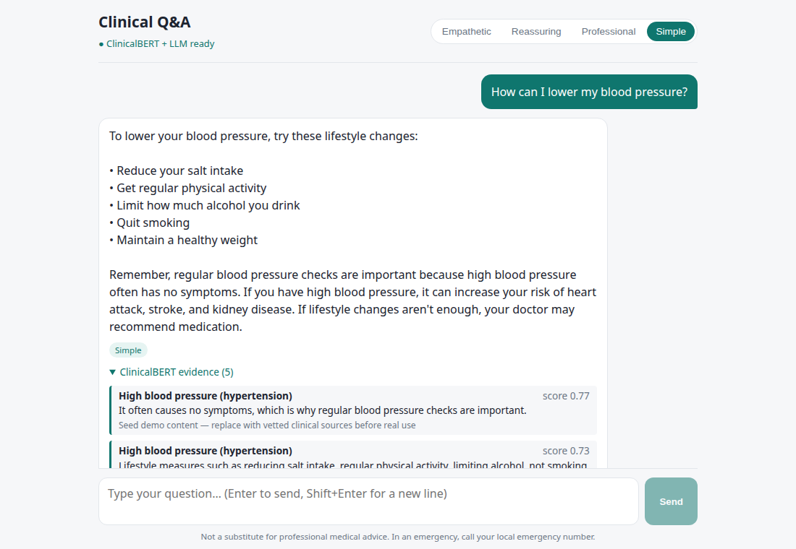
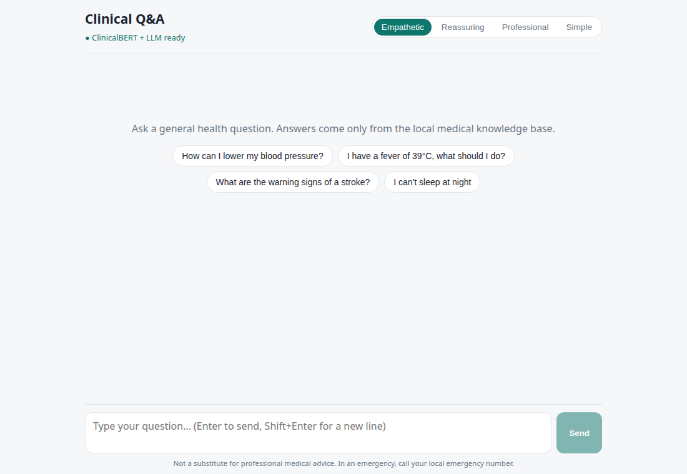
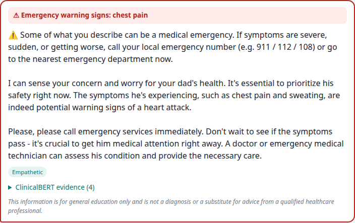
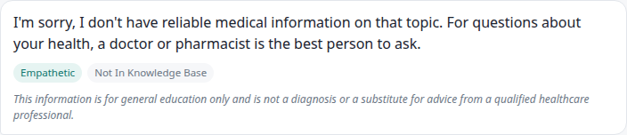
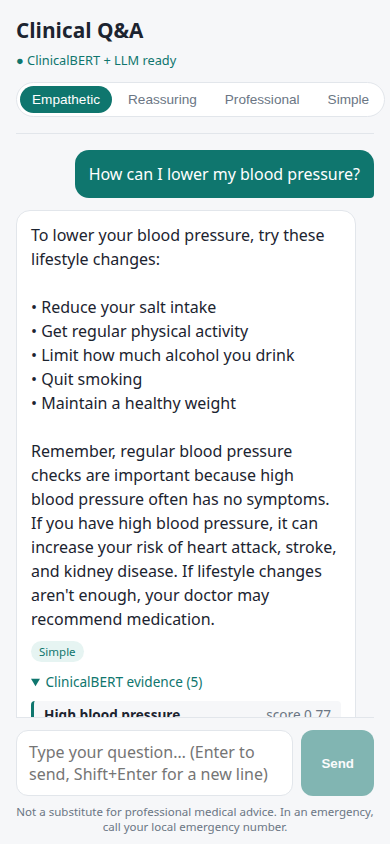
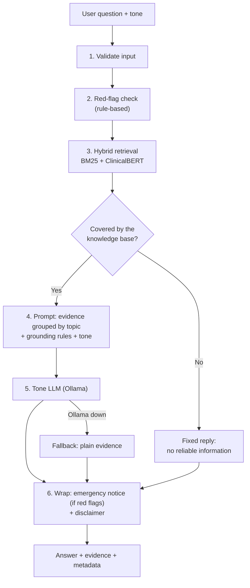
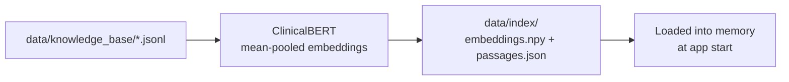
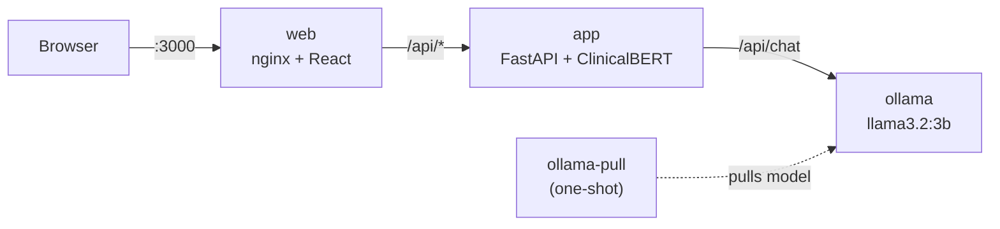

# Clinical NLP Local Pipeline

**Private, fully local medical Q&A.** A clinical language model (Bio_ClinicalBERT) finds the relevant
medical facts, and a local LLM explains them in the tone you choose. Nothing leaves your machine.



| | |
|---|---|
| **Clinical understanding** | `emilyalsentzer/Bio_ClinicalBERT` + BM25 hybrid retrieval |
| **Tone & empathy** | `llama3.2:3b` via Ollama (any Ollama model works) |
| **Interfaces** | React web UI · FastAPI · terminal chat |
| **Deployment** | One-command Docker Compose, runs offline on CPU |
| **Quality** | 19 unit tests + labelled retrieval evaluation (93.5% top-1 topic accuracy) |

> ⚠️ **Not a medical device.** For education and demonstration only. The bundled knowledge base is
> demo content and has not been clinically validated.

---

## Contents

- [Screenshots](#screenshots)
- [How it works](#how-it-works)
- [Quick start (Docker)](#quick-start-docker)
- [Local setup (without Docker)](#local-setup-without-docker)
- [Usage](#usage)
- [Knowledge base](#knowledge-base)
- [Evaluation](#evaluation)
- [Configuration](#configuration)
- [Safety design](#safety-design)
- [Known limitations](#known-limitations)
- [Development](#development)
- [Project layout](#project-layout)
- [License](#license)

---

## Screenshots

| Home | Emergency detection |
|---|---|
|  |  |

| Out-of-scope question | Mobile |
|---|---|
|  |  |

---

## How it works

ClinicalBERT is an **encoder**: it understands clinical language but cannot generate text. So the
work is split. ClinicalBERT and BM25 decide **what** to say (facts from the knowledge base), and the
LLM decides **how** to say it (tone and empathy), using only those facts.

### Request flow



1. **Validate:** empty questions and unknown tones are rejected (HTTP 422).
2. **Red-flag check** ([safety.py](src/clinical_pipeline/safety.py)): regex rules detect emergency
   phrases such as "chest pain", "slurred speech" or "kill myself".
3. **Hybrid retrieval** ([clinical_bert.py](src/clinical_pipeline/clinical_bert.py), [lexical.py](src/clinical_pipeline/lexical.py)):
   - BM25 decides whether the knowledge base covers the question (`MIN_LEXICAL_SCORE`).
   - Topics are ranked by `0.3 × ClinicalBERT similarity + 0.7 × BM25`.
   - A second topic is kept only if it scores ≥ 70% of the best one.
   - The best-matching sentences (up to 5) become the evidence.
4. **Prompt** ([tone_llm.py](src/clinical_pipeline/tone_llm.py)): evidence grouped by topic, plus rules:
   no new facts, numbers or doses, no diagnosis, never mix topics, and the selected tone.
5. **Tone LLM:** Ollama `/api/chat` writes the final wording.
6. **Wrap** ([pipeline.py](src/clinical_pipeline/pipeline.py)): emergency notice first when red
   flags were found, and an educational disclaimer on every answer.

### Indexing (once, before serving)



The index records which model built it, and the app refuses to start if it doesn't match the
configured model.

### Deployment (Docker Compose)



---

## Quick start (Docker)

Requirements: Docker with Compose v2. About 6 GB of disk (app image ~3.5 GB, LLM ~2 GB) and 8 GB RAM.

```bash
git clone <your-repo-url> clinical-nlp-local-pipeline
cd clinical-nlp-local-pipeline
docker compose up -d --build
```

The first run builds the images and downloads `llama3.2:3b`. When `docker compose ps` shows `app` as
**healthy**, open **http://localhost:3000**.

| Service | What it does |
|---|---|
| `web` | React UI served by nginx on port 3000; proxies `/api/*` to `app` |
| `app` | FastAPI on port 8000. ClinicalBERT is baked into the image (works offline); the index is built on first start |
| `ollama` | Local LLM server. Its port isn't published, to avoid clashing with an Ollama already on the host |
| `ollama-pull` | One-shot job that downloads the LLM and exits. **`Exited (0)` is expected** |

Common tasks:

```bash
docker compose logs -f app                                     # follow backend logs
docker compose exec app clinical-chat --tone simple "fever?"   # terminal chat in the container
REBUILD_INDEX=1 docker compose up -d --force-recreate app      # after editing the knowledge base
TONE_LLM_MODEL=llama3.1:8b WEB_PORT=8080 docker compose up -d  # different LLM / port
docker compose down                                            # stop (models and index are kept)
```

---

## Local setup (without Docker)

Requirements: Python 3.10+, [Ollama](https://ollama.com) running locally, and Node 20+ for the UI.

```bash
python3 -m venv .venv && source .venv/bin/activate
pip install torch --index-url https://download.pytorch.org/whl/cpu   # or the CUDA build
pip install -e ".[dev]"
cp .env.example .env

python scripts/download_models.py   # downloads ClinicalBERT + pulls the tone LLM
python scripts/build_index.py       # embeds the knowledge base with ClinicalBERT

uvicorn clinical_pipeline.api:app --app-dir src --port 8000      # API
cd frontend && npm install && npm run dev                       # UI at http://localhost:5173
```

After the first download, set `HF_HUB_OFFLINE=1` to guarantee no network access.

---

## Usage

### Web UI
Pick a tone (Empathetic, Reassuring, Professional, Simple), ask a question, and expand
**ClinicalBERT evidence** to see exactly which facts the answer was built from.

### HTTP API

```bash
curl -s localhost:8000/ask -H 'content-type: application/json' \
  -d '{"question": "What are the signs of a stroke?", "tone": "reassuring"}'
```

```json
{
  "answer": "…",
  "tone": "reassuring",
  "tone_applied": true,
  "is_relevant": true,
  "red_flags": [],
  "evidence": [{"sentence": "…", "score": 0.97, "title": "Stroke warning signs (FAST)", "source": "…"}],
  "disclaimer": "This information is for general education only …",
  "warnings": []
}
```

`GET /health` → `{"clinical_bert": "loaded", "tone_llm_ready": true}`. Interactive docs are at `/docs`.

### Terminal

```bash
clinical-chat                                                      # interactive; /tone simple, /quit
clinical-chat --tone simple --show-evidence "How can I lower my blood pressure?"
```

---

## Knowledge base

The pipeline answers **only** from `data/knowledge_base/*.jsonl`, one JSON object per line:

```json
{"id": "hypertension", "title": "High blood pressure (hypertension)", "text": "…", "source": "…"}
```

`seed_medical_kb.jsonl` contains **14 short demo topics** (hypertension, diabetes, fever, stroke,
asthma, anxiety, …). Replace or extend it with vetted clinical content, then rebuild the index
(`python scripts/build_index.py`, or `REBUILD_INDEX=1` in Docker).

---

## Evaluation

```bash
python scripts/evaluate.py    # writes eval/results.md and eval/results.json
```

Labelled set: [eval/questions.jsonl](eval/questions.jsonl).
- **46 in-scope questions:** 31 share keywords with the knowledge base, 15 are lay-language paraphrases.
- **12 out-of-scope questions:** 6 non-medical, 6 medical but not covered.

Full report with every failure: [eval/results.md](eval/results.md).

| Method | Top-1 topic | Recall@3 | Top-1 on paraphrases |
|---|---|---|---|
| BM25 only | 89.1% | 93.5% | 66.7% |
| ClinicalBERT only | 56.5% | 89.1% | 46.7% |
| **Hybrid (deployed, α = 0.3)** | **93.5%** | **97.8%** | **80.0%** |

| Detecting out-of-scope questions (AUROC) | |
|---|---|
| BM25 best score | 0.959 |
| ClinicalBERT best cosine | 0.792 |

**Takeaways**
- Raw ClinicalBERT is a weak retriever on its own. Combined with BM25 it adds value, mostly on lay
  paraphrases (66.7% → 80.0%), where exact keywords are missing.
- BM25 is the better relevance signal, which is why it decides whether a question is covered.
- The relevance gate is the weakest part: only **7 of 12 out-of-scope questions are rejected**.
  Generic words such as "causes", "treated" or "last" are enough to pass it.
- **Caveats:**
  - The set is small and hand-written; a 2-question change moves Top-1 by about 4 points.
  - α = 0.3 was chosen before this evaluation existed. The α sweep shows 0.3–0.4 perform best,
    so tuning further on this set would overfit it.

---

## Configuration

Set in `.env` (local) or as environment variables (Docker). See [.env.example](.env.example).

| Variable | Default | Meaning |
|---|---|---|
| `CLINICAL_BERT_MODEL` | `emilyalsentzer/Bio_ClinicalBERT` | Any BERT-family HF model; rebuild the index after changing it |
| `TONE_LLM_MODEL` | `llama3.2:3b` | Any Ollama model; larger models follow grounding rules better |
| `DEFAULT_TONE` | `empathetic` | `empathetic` · `reassuring` · `professional` · `simple` |
| `MIN_LEXICAL_SCORE` | `1.0` | BM25 threshold below which a question counts as "not covered" |
| `HYBRID_ALPHA` | `0.3` | Weight of ClinicalBERT vs BM25 when ranking (0–1) |
| `PASSAGE_KEEP_RATIO` | `0.7` | Keep a second topic only if it scores ≥ ratio × the best topic |
| `TOP_K_PASSAGES` / `TOP_K_SENTENCES` | `3` / `5` | How much evidence goes to the LLM |
| `OLLAMA_HOST` | `http://localhost:11434` | Ollama URL (`http://ollama:11434` in Docker) |
| `DEVICE` | `cpu` | `cpu` or `cuda` |

---

## Safety design

- **Emergency detection is rule-based** and independent of both models. An emergency notice is
  always placed first when red flags are found.
- **Grounded generation:** the LLM sees only retrieved evidence, grouped by topic, and is told not
  to add facts, numbers, drugs or doses.
- **No evidence, no LLM:** uncovered questions get a fixed reply, so the LLM never improvises.
- **Graceful degradation:** if Ollama is down, the plain evidence is returned (`tone_applied: false`).
- **Transparency:** every answer exposes its evidence and sources, and carries a disclaimer.

---

## Known limitations

1. **Raw Bio_ClinicalBERT wasn't trained for similarity search.** It is a masked language model,
   so its cosine scores cluster around 0.8–0.9 for related *and* unrelated text. Fine-tuning it on
   clinical question–passage pairs is the natural next step.
2. **The relevance gate is permissive:** 5 of 12 out-of-scope test questions get through (see
   [Evaluation](#evaluation)). They are still answered only from knowledge-base facts, but those
   facts can be off-topic.
3. **Small LLMs embellish:** `llama3.2:3b` occasionally adds minor wording that isn't in the evidence.
   Use a larger Ollama model for anything beyond a demo.
4. **BM25 needs shared words:** "dehydrated" doesn't match "dehydration", so some valid questions
   are judged "not covered".
5. **CPU latency:** answers take about 10–20 s on CPU, mostly LLM generation. Answers are not streamed.
6. **No authentication or rate limiting.** Intended for local use.

---

## Development

```bash
pytest -q                                                     # 19 unit tests, no model downloads
python scripts/evaluate.py                                    # retrieval evaluation
cd frontend && npm run build                                  # production UI build
```

Tests use a deterministic fake encoder and fake LLM, so they run in under a second.

---

## Project layout

```
src/clinical_pipeline/
  config.py            settings from .env
  knowledge_base.py    JSONL loader + sentence splitter
  lexical.py           BM25
  clinical_bert.py     ClinicalBERT encoder, vector index, hybrid retriever
  tone_llm.py          Ollama client + tone prompts
  safety.py            red-flag rules, disclaimer
  pipeline.py          orchestration + fallbacks
  api.py / cli.py      FastAPI server / terminal chat
  indexer.py           index builder
  evaluation.py        retrieval metrics + report
frontend/              React (Vite) UI, nginx config, Dockerfile
scripts/               download_models.py, build_index.py, evaluate.py
eval/                  questions.jsonl, results.md, results.json
data/knowledge_base/   seed_medical_kb.jsonl
docker/                entrypoint.sh
docs/screenshots/      README images
tests/                 unit tests
Dockerfile, docker-compose.yml
```

---

## License

Code is released under the [MIT License](LICENSE).

Third-party models keep their own licenses. Check them before redistributing:
- [Bio_ClinicalBERT](https://huggingface.co/emilyalsentzer/Bio_ClinicalBERT) (Alsentzer et al., 2019, *Publicly Available Clinical BERT Embeddings*)
- [Llama 3.2](https://www.llama.com/llama3_2/license/) (Llama 3.2 Community License)
